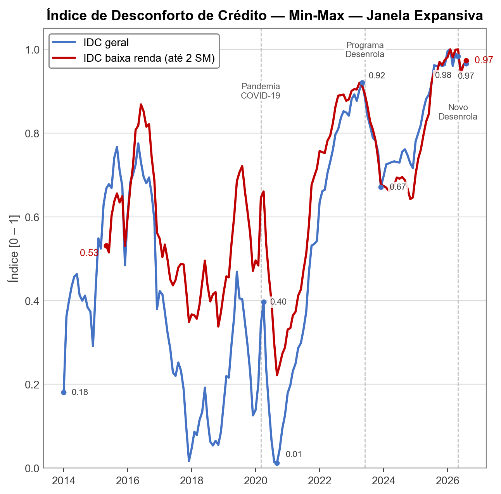
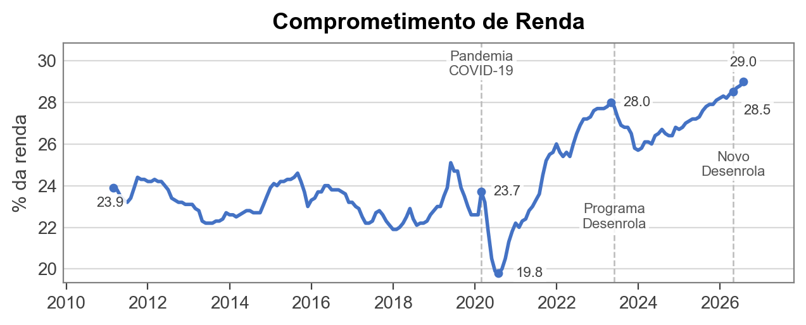
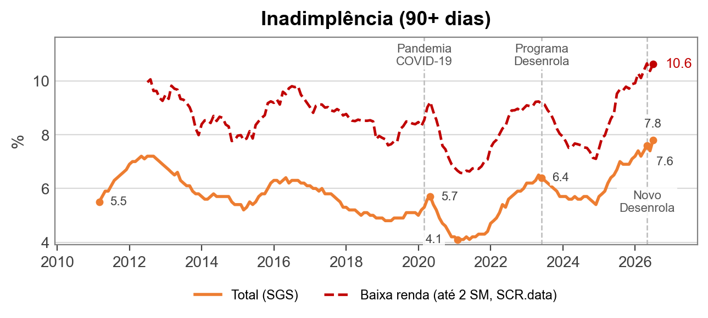
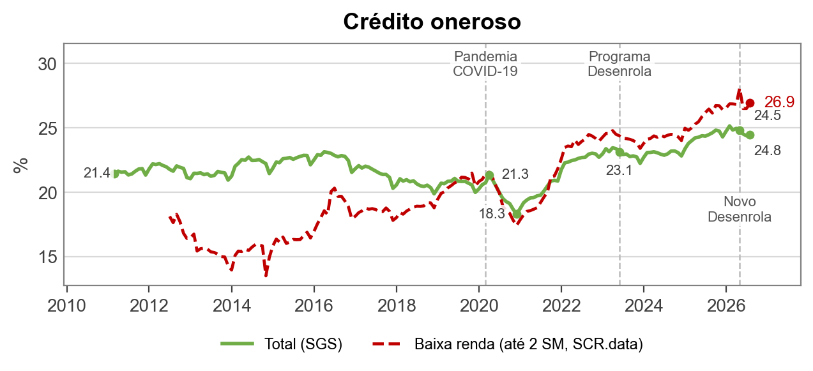

# Índice de Desconforto de Crédito

Autores: Lauro Gonzalez, Matheus L. Carrijo, Rafael Schiozer

Este repositório contém o código e a documentação para a construção de um **índice** que captura o nível de desconforto de crédito das famílias brasileiras.

## Atualização outubro/2026 — competência ago/2026

**O IDC mostra quão perto o desconforto de crédito das famílias está do pior nível já observado no histórico disponível.**


Com a divulgação em **outubro de 2026** das estatísticas monetárias e de crédito do Banco Central, o último mês calculável do IDC é **ago-2026**, pois a série de comprometimento de renda está disponível somente até esse mês.

<!-- IDC_LATEST_START -->
| Indicador | Valor bruto | Valor normalizado |
|---|---:|---:|
| IDC | — | **0,966** |
| C — comprometimento de renda | 29,0% | 1,000 |
| I — inadimplência 90+ dias | 8,0% | 1,000 |
| Q — crédito oneroso no crédito livre PF | 24,5% | 0,898 |
<!-- IDC_LATEST_END -->


O valor **0,966** indica que, em ago-2026, o desconforto de crédito permaneceu próximo do ponto máximo da janela histórica observada pelo índice. Em relação a jul-2026, recalculado em **0,963** com a mesma safra de dados, houve alta de **0,004 ponto** (com base nos valores não arredondados): a participação das modalidades onerosas no crédito livre PF voltou a subir, enquanto o comprometimento de renda e a inadimplência, que já estavam no máximo da amostra, atingiram novos máximos brutos (**29,0%** e **8,0%**) sem alterar seus valores normalizados.

É importante destacar que o IDC não é uma medida absoluta de endividamento; ele indica a posição do mês corrente em relação ao histórico disponível.

### Estatísticas Descritivas do IDC

<!-- IDC_STATS_START -->
| Estatística | Valor |
|---|---:|
| Último dado | ago-2026 |
| Atual | 0,966 |
| Média | 0,528 |
| Desvio padrão | 0,296 |
| Mínimo | 0,013 |
| Máximo | 1,000 |
<!-- IDC_STATS_END -->

### IDC para a população de baixa renda

O **IDC para baixa renda** aplica a mesma construção a tomadores pessoa física com renda de até 2 salários mínimos, incluindo os sem rendimento. O componente C é o do IDC geral, porque o Banco Central não divulga o comprometimento de renda por faixa de renda; I e Q são calculados para o grupo com o SCR.data, normalizados desde jul-2012 e exibidos a partir de mai-2015.

<!-- IDC_LOW_INCOME_START -->
| Indicador | Valor bruto | Valor normalizado |
|---|---:|---:|
| IDC baixa renda | — | **0,974** |
| C — comprometimento de renda (nacional) | — | 1,000 |
| I — inadimplência 90+ dias (até 2 SM) | 10,8% | 1,000 |
| Q — crédito oneroso (até 2 SM) | 26,9% | 0,921 |

Último dado: ago-2026; série exibida desde mai-2015 (média 0,650, mínimo 0,222, máximo 1,000).
<!-- IDC_LOW_INCOME_END -->


## Séries Completas

### IDC



### Componentes Brutos







## Divulgação e Repercussão

O relatório original de divulgação da criação do índice foi publicado em [Índice de Desconforto de Crédito (IDC)](https://eaesp.fgv.br/producao-intelectual/indice-desconforto-credito-idc). A partir da divulgação inicial, o IDC é atualizado e divulgado sempre que o Banco Central atualiza os dados usados no índice, possivelmente em frequência mensal.

A criação do IDC e seus resultados iniciais foram repercutidos em reportagens e artigo de opinião:

- [R7 — Desconforto do brasileiro com o crédito atinge maior nível em 12 anos; entenda](https://noticias.r7.com/economia/desconforto-do-brasileiro-com-o-credito-atinge-maior-nivel-em-12-anos-entenda-27042026/) (27/04/2026)
- [UOL — Novo indicador da FGV mede mal-estar da população com o endividamento](https://economia.uol.com.br/colunas/mariana-barbosa/2026/04/24/novo-indicador-da-fgv-mede-mal-estar-da-populacao-com-o-endividamento.htm) (24/04/2026)
- [Valor Econômico — Desconforto das famílias com crédito atinge o maior nível em 12 anos, diz FGV EAESP](https://valor.globo.com/brasil/noticia/2026/04/24/desconforto-das-famlias-com-crdito-atinge-o-maior-nvel-em-12-anos-diz-fgv-eaesp.ghtml) (24/04/2026)
- [Valor Econômico — Medindo o desconforto do crédito no Brasil](https://valor.globo.com/opiniao/coluna/medindo-o-desconforto-do-credito-no-brasil.ghtml), artigo de opinião sobre o IDC.
- [SBT News — Famílias comprometem 29% da renda com dívidas e pressão do crédito cresce](https://sbtnews.sbt.com.br/noticia/economia/familias-comprometem-29-da-renda-com-dividas-e-pressao-do-credito-cresce) (24/04/2026)

## 1. Motivação

O projeto surge no contexto de:

- Crescente debate público sobre **endividamento das famílias**
- Políticas recentes como o **Programa Desenrola**
- Interesse em criar uma métrica análoga ao "índice de desconforto econômico" tradicional (inflação + desemprego), mas focada em **crédito**

## 2. Estrutura do Índice

O índice é composto por **três dimensões**, cada uma com dados disponíveis na planilha mensal de Estatísticas Monetárias e de Crédito do Banco Central, armazenada em `data/raw/YYYYMM/` com o prefixo de competência usado pelo próprio BC. Para mais informações sobre os dados, ver a seção 8 abaixo.

### 2.1. Comprometimento de renda com dívida

- Código SGS: `29034`
- Conceito: Comprometimento de renda - Relação entre o valor correspondente aos pagamentos esperados para o serviço da dívida com o Sistema Financeiro Nacional e a renda mensal das famílias, em média móvel trimestral, ajustado sazonalmente.
- Para mais informações sobre a série: [https://dadosabertos.bcb.gov.br/dataset/29034-comprometimento-de-renda-das-familias-com-o-servico-da-divida-com-o-sistema-financeiro-nacion](https://dadosabertos.bcb.gov.br/dataset/29034-comprometimento-de-renda-das-familias-com-o-servico-da-divida-com-o-sistema-financeiro-nacion)

### 2.2. Inadimplência da carteira de crédito (90+ dias)

- Código SGS: `21112`
- Conceito: Percentual da carteira de crédito livre do Sistema Financeiro Nacional com pelo menos uma parcela com atraso superior a 90 dias. Não inclui operações referenciadas em taxas regulamentadas, operações vinculadas a recursos do BNDES ou quaisquer outras lastreadas em recursos compulsórios ou governamentais.
- Para mais informações sobre a série: [https://dadosabertos.bcb.gov.br/dataset/21112-inadimplencia-da-carteira-de-credito-com-recursos-livres---pessoas-fisicas---total](https://dadosabertos.bcb.gov.br/dataset/21112-inadimplencia-da-carteira-de-credito-com-recursos-livres---pessoas-fisicas---total)

### 2.3. Participação do crédito oneroso (composição do crédito "caro")

Mede a fração do crédito livre de pessoa física alocada em modalidades consideradas mais onerosas.

Componentes:

- Cheque especial (código SGS: `20573`)
- Crédito pessoal não consignado (código SGS: `20574`)
- Cartão de crédito rotativo (código SGS: `20587`)
- Cartão de crédito parcelado (código SGS: `20588`)

Métrica:

- Participação dessas modalidades no total de crédito livre para pessoa física (código SGS: `20570`), expressa como **fração [0, 1]** (e.g., 0,21 = 21% do crédito livre PF alocado em modalidades onerosas)

## 3. Construção do Índice

### 3.1. Normalização Min-Max

Como as três séries têm escalas distintas, cada componente é normalizado antes da agregação utilizando o método **Min-Max** com **janela expansiva**:

$$
x^{norm}_t = \frac{x_t - \min_\tau(x)}{\max_\tau(x) - \min_\tau(x)}
$$

onde $\min_\tau$ e $\max_\tau$ denotam o mínimo e o máximo calculados sobre a janela de referência $\tau = \{1, \ldots, t\}$. O resultado indica **qual fração do range histórico o valor atual representa**: 0 corresponde ao mínimo histórico e 1 ao máximo.

A janela é **expansiva** — cresce a partir do início da amostra (mar-2011), sem viés de lookahead: em cada período $t$, utilizam-se apenas observações disponíveis até $t$. Os primeiros anos do histórico servem como período de aquecimento; o índice é exibido a partir de **jan-2014** (~34 meses de aquecimento).

Cada atualização mensal compara integralmente a nova planilha do Banco Central com a divulgação imediatamente anterior. Observações novas são separadas de alterações na cobertura histórica, inclusive revisões e preenchimentos retroativos, e toda a série do IDC é recalculada com a safra mais recente.

A auditoria técnica preserva todas as diferenças, mas o relatório público aplica uma regra estrita de dupla materialidade. Uma revisão rotineira só recebe a seção `Revisões dos dados` quando altera o IDC em pelo menos **0,010 ponto** e afeta um elemento efetivamente discutido na nota, como a variação mensal, um recorde, uma sequência ou a conclusão. Inversão de sinal, criação ou remoção de recorde, invalidação de afirmação publicada, mudança metodológica do IDC, mudança de fonte ou cobertura, ou correção de erro relevante podem justificar o destaque independentemente do limiar. Pequenas revisões sucessivas são avaliadas pelo efeito líquido acumulado desde a última divulgação pública de revisão. Quando a seção é necessária, ela mostra somente as competências materiais ou indispensáveis para explicar a base de comparação, na mesma precisão de três casas usada para o IDC; a precisão integral permanece no registro técnico.

### 3.2. Agregação

Após normalização, o índice é calculado como média simples dos três componentes:

$$
\text{Índice}_t = \frac{1}{3} (C_t + I_t + Q_t)
$$

onde:

- $C_t$: comprometimento de renda (normalizado)
- $I_t$: inadimplência (normalizada)
- $Q_t$: participação do crédito oneroso (normalizada)

### 3.3. IDC para a população de baixa renda

Além do IDC geral, o projeto calcula o **IDC para baixa renda**: o mesmo índice, aplicado a tomadores pessoa física com renda de até 2 salários mínimos, **incluindo os sem rendimento**, segundo a faixa de renda informada ao Sistema de Informações de Crédito (SCR).

$$
\text{IDC baixa renda}_t = \frac{1}{3} \left( C_t + I_t^{\text{baixa renda}} + Q_t^{\text{baixa renda}} \right)
$$

- **C é o do IDC geral**, porque o Banco Central não divulga o comprometimento de renda por faixa de renda. As diferenças entre os dois índices vêm, portanto, só de I e Q. Em teste com o comprometimento de renda individual por faixa publicado no Relatório de Estabilidade Financeira de abril de 2025 (dez-2020 a dez-2024), o C nacional acompanha parte da dinâmica de cada faixa, mas não o nível: ele é uma aproximação.
- **I e Q do grupo** vêm do [SCR.data](https://dadosabertos.bcb.gov.br/dataset/scr_data), os dados agregados do SCR (crédito livre de pessoas físicas, exceto financiamento rural, imobiliário e de exportação ou importação; `src/scr_data.py`). I é a inadimplência acima de 90 dias e Q, a participação das mesmas quatro modalidades onerosas do IDC geral.
- **Normalização:** min-max com janela expansiva desde **jul-2012**, o primeiro mês do SCR.data. O índice é exibido a partir de **mai-2015**, 34 meses depois, o mesmo período de aquecimento do IDC geral.
- **Qualidade dos dados:** o SCR.data é reconciliado todo mês com as séries oficiais (I e Q nacionais). Se o SCR.data não cobrir o mês de referência do IDC ou divergir das séries oficiais em mais de 0,75 ponto percentual, o IDC para baixa renda **não é atualizado naquela edição** (`data/processed/low_income_status.json` registra o motivo) e o IDC geral segue normalmente, pois não depende dessa fonte.

### 3.4. Apêndice estatístico

Cada edição pode ter um **apêndice estatístico**, em PDF separado da nota (`outputs/report/update-YYYYMM/idc-apendice-YYYYMM.pdf`), gerado por `python -m src.build_appendix YYYYMM`. Ele detalha os dois índices, decompõe as variações de I, Q e C, decompõe I e Q por faixa de renda, credor, ocupação e unidade da federação, calcula o IDC para as quatro faixas de renda, testa o C nacional e documenta a conciliação e os limites do SCR.data. Todos os números do texto vêm dos dados.

## 4. Horizonte Temporal

O horizonte efetivo do índice é determinado pela série mais curta disponível na planilha mensal do Banco Central — em geral, a SGS 29034 (comprometimento de renda), que é publicada com maior defasagem que as demais. A planilha pode conter observações mais recentes para algumas séries, mas o índice usa apenas os meses em que os três componentes C, I e Q estão disponíveis. O índice é exibido a partir de **jan-2014**, após ~34 meses de aquecimento da janela expansiva.

Assim, a competência da divulgação do Banco Central não necessariamente coincide com o último mês calculável do IDC. Por exemplo, a divulgação **202610** traz a série de comprometimento de renda até **ago-2026** e as demais séries usadas no índice até **set-2026**; como o IDC exige todos os componentes no mesmo mês, o índice calculado com essa divulgação termina em **ago-2026**.

## 5. Como Reproduzir

**Pré-requisitos:** Python 3.11+ com as dependências listadas em `requirements.txt`. O projeto usa `uv` para criar e sincronizar o ambiente local:

```bash
uv venv
uv pip install -r requirements.txt
source .venv/bin/activate
```

**Atualização mensal dos dados do Banco Central** a partir do diretório raiz do projeto:

```bash
python -m src.download_bcb_release 202610
```

O comando acima baixa a tabela XLSX e o PDF do relatório mensal do Banco Central para `data/raw/202610/`. Por padrão, arquivos existentes não são sobrescritos; use `--overwrite` para forçar novo download.

Se o ambiente local não conseguir alcançar o site do BCB por uma falha de rede que não seja HTTP 404, o mesmo arquivo oficial pode ser obtido por um runner do GitHub Actions:

```bash
python -m src.download_bcb_via_github 202610
```

Esse fallback requer `gh auth status` válido e o workflow `fetch-bcb-release.yml` disponível na branch `main`. O runner baixa os arquivos do BCB, valida as assinaturas XLSX/PDF e os devolve como artefato antes de a execução local do índice continuar.

Antes de executar o índice, audite eventuais revisões da divulgação atual contra a imediatamente anterior:

```bash
python -m src.compare_releases 202610
```

**Execução do índice** a partir do diretório raiz do projeto:

```bash
python main.py
```

O script carrega automaticamente a planilha mais recente em `data/raw/YYYYMM/`, constrói os três componentes e o índice (normalização min-max com janela expansiva), calcula o IDC para baixa renda quando o SCR.data está disponível, salva os CSVs em `data/processed/` e as figuras em `outputs/figures/`. O relatório final do projeto fica em `outputs/report/`.

**Dados do SCR.data** (IDC para baixa renda e apêndice), antes de `python main.py`:

```bash
python -m src.scr_data refresh   # baixa só os ZIPs anuais que mudaram (a primeira vez baixa tudo, cerca de 1,3 GB)
```

**Relatório e apêndice** de uma divulgação, depois de preencher o LaTeX da nota (ver [`PIPELINE.md`](PIPELINE.md)):

```bash
python -m src.insert_low_income 202610   # insere o IDC para baixa renda no .tex preenchido da nota
python -m src.build_appendix 202610      # gera o PDF do apêndice estatístico
```

Cada nota mensal é gerada localmente em três formatos com o mesmo conteúdo: fonte LaTeX (`.tex`), PDF compilado (`.pdf`) e documento Word editável (`.docx`). Somente o PDF final é versionado e publicado no GitHub. Fontes, arquivos auxiliares de construção, DOCX, imagens copiadas para o relatório, auditorias de revisão e templates permanecem locais e são ignorados pelo Git. Depois de preencher e revisar o LaTeX, gere o DOCX diretamente da mesma fonte para evitar versões divergentes:

```bash
python -m src.build_report_docx \
  outputs/report/update-202610/idc-update-202610.tex \
  outputs/report/update-202610/idc-update-202610.docx \
  --assets-dir outputs/report/update-202610 \
  --require-filled
```

O processo mensal completo, inclusive a compilação e a revisão visual do PDF e do DOCX, está documentado em [`PIPELINE.md`](PIPELINE.md).

Para gerar relatórios em uma nova cópia do repositório, disponibilize localmente o template mestre `outputs/report/template-latex/template.tex` e seu `logo.png`. Esses arquivos não são incluídos no clone do GitHub.

## 6. Estrutura do Repositório

```
├── data/
│   ├── raw/
│   │   ├── 202603/
│   │   │   ├── 202603_Tabelas_de_estatisticas_monetarias_e_de_credito.xlsx
│   │   │   └── 202603_Texto_de_estatisticas_monetarias_e_de_credito.pdf
│   │   └── 202610/
│   │       ├── 202610_Tabelas_de_estatisticas_monetarias_e_de_credito.xlsx
│   │       └── 202610_Texto_de_estatisticas_monetarias_e_de_credito.pdf
│   ├── external/
│   │   └── cri_faixa_ref202504.csv   # CRI por faixa de renda (REF abr/2025), usado no teste do C nacional
│   └── processed/
│       ├── series_raw.csv
│       ├── components_raw.csv
│       ├── index.csv
│       ├── low_income_idc.csv        # IDC para baixa renda (jul-2012 em diante; exibido desde mai-2015)
│       ├── low_income_status.json    # situação do IDC para baixa renda na última rodada
│       ├── sgs_snapshot.csv          # séries do SGS usadas no apêndice
│       └── scr/                      # agregados do SCR.data (4 lentes) e datas de geração dos arquivos
├── src/
│   ├── build_report_docx.py      # converte o relatório LaTeX preenchido em DOCX editável
│   ├── download_bcb_release.py   # baixa a divulgação mensal do BCB (XLSX + PDF)
│   ├── download_bcb_via_github.py # fallback de download por GitHub Actions
│   ├── load_data.py     # carrega as séries do Excel
│   ├── normalize.py     # normalização min-max com janela expansiva
│   ├── build_index.py   # constrói componentes C, I, Q e agrega o índice
│   ├── plot.py          # gera as figuras (com as linhas de baixa renda quando disponíveis)
│   ├── plot_overlay.py  # linhas do IDC para baixa renda sobre as figuras
│   ├── scr_data.py      # baixa, valida e agrega o SCR.data (atualização incremental)
│   ├── sgs_api.py       # cliente da API do SGS (séries do apêndice)
│   ├── lenses.py, anatomy.py, income_idc.py, ref_check.py  # decomposições, IDC por faixa e teste do C nacional
│   ├── low_income.py    # série e textos do IDC para baixa renda; portão de qualidade
│   ├── insert_low_income.py  # insere o IDC para baixa renda no .tex preenchido da nota
│   ├── exhibits.py, extras.py, plot_extras.py, pt_format.py, workbook_tables.py  # tabelas, textos e figuras
│   ├── appendix_data.py, appendix_text.py, appendix_document.py  # dados, texto e montagem do apêndice
│   └── build_appendix.py # gera o PDF do apêndice estatístico
├── outputs/
│   ├── figures/         # 6 figuras (PNG)
│   └── report/          # PDFs finais versionados; templates e auxiliares locais
├── main.py              # ponto de entrada
├── CITATION.cff         # autoria e citação recomendada
├── LICENSE              # licença MIT para o código-fonte
├── LICENSE-DATA.md      # licença CC BY 4.0 para documentação e outputs autorais
├── requirements.txt
└── README.md
```

## 7. Outputs Gerados

**Dados (`data/processed/`):**

- **`series_raw.csv`** — séries brutas carregadas do Excel
- **`components_raw.csv`** — componentes C, I, Q antes da normalização
- **`index.csv`** — componentes normalizados (C_norm, I_norm, Q_norm) e índice agregado (a partir de jan-2014)
- **`low_income_idc.csv`** — IDC para baixa renda: I e Q do grupo (em %), seus valores normalizados, C normalizado e o índice (a série é calculada desde jul-2012 e exibida a partir de mai-2015)
- **`low_income_status.json`** — situação do IDC para baixa renda na última rodada (`ok`, `bloqueio`, `sem_cobertura` ou `sem_dados`), o motivo e os números da conciliação com as séries oficiais
- **`scr/`** — agregados mensais do SCR.data por faixa de renda, credor, ocupação e unidade da federação, e as datas de geração dos arquivos do Banco Central
- **`sgs_snapshot.csv`** — séries do SGS usadas no apêndice (saldos e inadimplência por modalidade e partes do comprometimento de renda)

**Figuras (`outputs/figures/`):**

| Arquivo | Conteúdo |
|---|---|
| `components_raw.png` | Componentes C, I, Q em valores brutos (não normalizados) |
| `components_raw_c.png` | Componente C em valores brutos |
| `components_raw_i.png` | Componente I em valores brutos |
| `components_raw_q.png` | Componente Q em valores brutos |
| `components_normalized.png` | Componentes normalizados por Min-Max sobrepostos |
| `index.png` | Índice de Desconforto de Crédito (com o IDC para baixa renda, quando disponível) |

As figuras de I, de Q, dos componentes normalizados e do índice mostram também as linhas do grupo de baixa renda (tracejadas nos componentes) quando o IDC para baixa renda está disponível.

**Relatório (`outputs/report/`):**

- **`update-202610/idc-update-202610.pdf`** — nota mensal compilada e verificada; único formato da nota versionado no GitHub.
- **`update-202610/idc-apendice-202610.pdf`** — apêndice estatístico da edição (quando o SCR.data permite gerá-lo), em documento separado da nota.

O LaTeX preenchido, o Word editável, os templates, as imagens auxiliares e a auditoria técnica de revisão são preservados apenas no ambiente local de geração.

## 8. Estrutura e Fontes de Dados

Os arquivos mensais em **`data/raw/YYYYMM/`** são a **fonte primária** para a construção do índice. Cada pasta mensal preserva o prefixo de competência `YYYYMM` usado pelo Banco Central no arquivo disponibilizado para download.

Para cada competência, são armazenados dois arquivos:

- **`YYYYMM_Tabelas_de_estatisticas_monetarias_e_de_credito.xlsx`** — planilha usada no cálculo do índice.
- **`YYYYMM_Texto_de_estatisticas_monetarias_e_de_credito.pdf`** — relatório do Banco Central que acompanha a divulgação mensal dos dados.

O módulo `src.load_data` localiza automaticamente a planilha mais recente disponível em `data/raw/YYYYMM/`. O script `src.download_bcb_release` automatiza o download mensal desses dois arquivos:

```bash
python -m src.download_bcb_release YYYYMM
```

- Obtido em: [https://www.bcb.gov.br/estatisticas/estatisticasmonetariascredito](https://www.bcb.gov.br/estatisticas/estatisticasmonetariascredito)
- Trata-se de uma **compilação oficial do Banco Central do Brasil** de um subconjunto selecionado de séries temporais do Sistema Gerenciador de Séries Temporais (SGS).
- Reúne, em uma única planilha, as principais séries necessárias para o índice.
- As observações mais recentes são marcadas com `*` na planilha, indicando **dados preliminares** sujeitos a revisão. Essas observações são incluídas no índice sem tratamento especial.

**SCR.data (IDC para baixa renda e apêndice).** Os dados agregados do Sistema de Informações de Crédito (SCR) são divulgados pelo Banco Central em um arquivo ZIP por ano, com um CSV por mês, a partir de jul-2012 e com defasagem de cerca de 38 dias ([dados abertos do BCB](https://dadosabertos.bcb.gov.br/dataset/scr_data)). O Banco Central **reprocessa os arquivos continuamente**, de modo que valores de um mesmo mês podem mudar entre uma edição e outra; `src.scr_data` guarda a data de geração de cada arquivo em `data/processed/scr/scr_vintage.csv` e baixa de novo apenas os anos cujo ZIP mudou. A licença do SCR.data é a Open Database License (ODbL): ver a seção 10.

**Identificação das séries dentro da planilha:** em cada aba, uma linha de cabeçalho `SGS` contém o número identificador de cada série no sistema SGS/BCB. A posição dessa linha pode variar entre divulgações; o carregador localiza dinamicamente esse cabeçalho antes de ler as observações.

---

## 9. Autoria e Citação

O Índice de Desconforto de Crédito (IDC) foi idealizado e implementado por **Lauro Gonzalez**, **Matheus L. Carrijo** e **Rafael Schiozer**, pesquisadores integrantes do **FGVcemif** e da **FGV-EAESP**.

Ao citar ou reutilizar o IDC, recomenda-se a seguinte referência:

> Gonzalez, Lauro; Carrijo, Matheus L.; Schiozer, Rafael. Índice de Desconforto de Crédito (IDC). FGVcemif/FGV-EAESP.

Veja também o arquivo [CITATION.cff](CITATION.cff).

## 10. Licença

Este repositório usa licenciamento em camadas:

- O **código-fonte** é disponibilizado sob a [MIT License](LICENSE).
- A **documentação autoral, metodologia autoral, figuras, componentes calculados e índice agregado produzidos pelo IDC** são disponibilizados sob a [Creative Commons Attribution 4.0 International (CC BY 4.0)](LICENSE-DATA.md), salvo indicação em contrário.
- Os **agregados derivados do SCR.data** em `data/processed/scr/` são uma base de dados derivada do SCR.data do Banco Central e seguem a [Open Database License (ODbL) 1.0](https://opendatacommons.org/licenses/odbl/1-0/) (atribuição e compartilhamento pela mesma licença); ver [LICENSE-DATA.md](LICENSE-DATA.md).
- **Dados brutos, planilhas, relatórios, PDFs, documentação metodológica e demais materiais obtidos do Banco Central do Brasil ou de terceiros não são relicenciados por este repositório**. Esses materiais permanecem sujeitos aos termos, licenças e condições das respectivas fontes originais.
